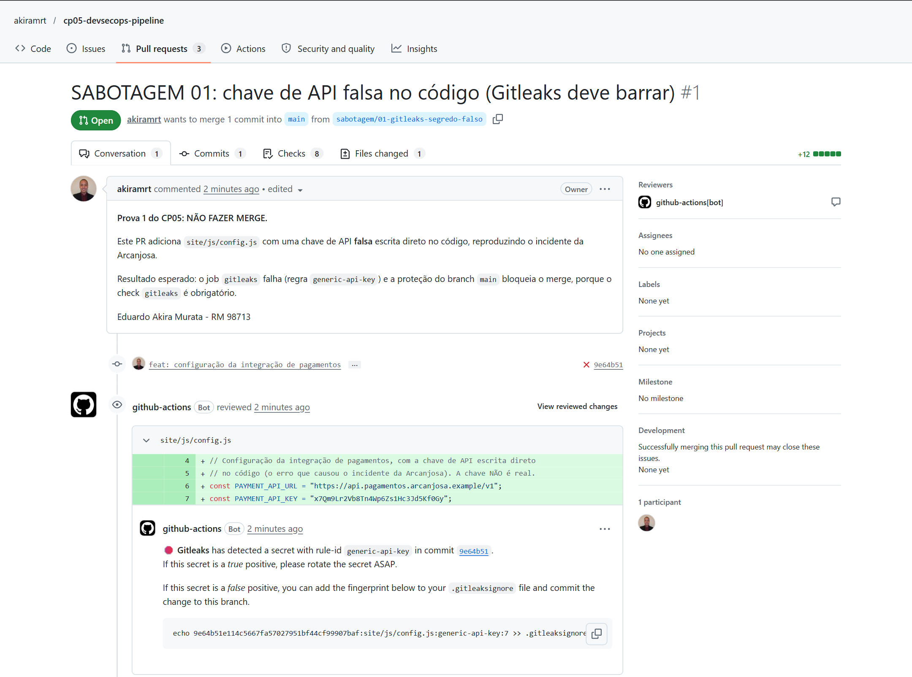
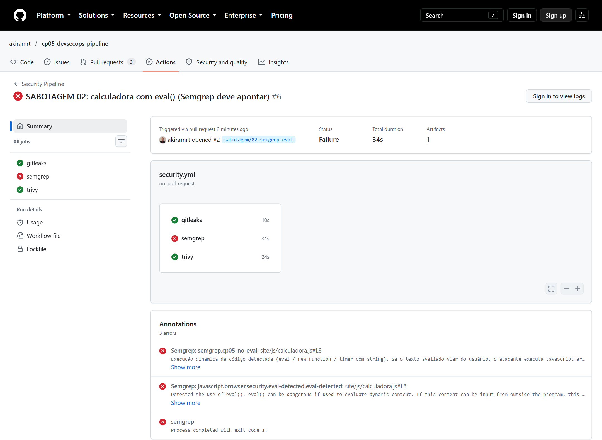
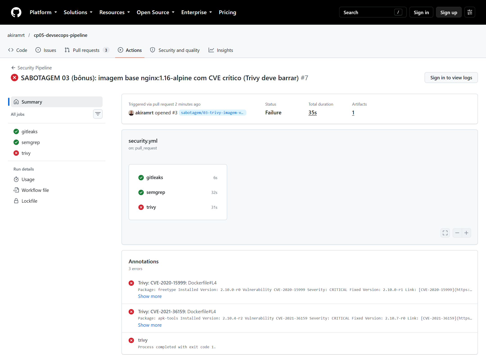

# CP05 — O Pipeline DevSecOps Completo

[](https://github.com/akiramrt/cp05-devsecops-pipeline/actions/workflows/security.yml)

**Aluno:** Eduardo Akira Murata · **RM 98713**<br>
**Turma:** 4ESR-2026 · FIAP Engenharia de Software<br>
**Disciplina:** DevSecOps and Cloud Computing · Checkpoint 05<br>
**Entrega (PDF):** [`docs/CP05_Eduardo_Akira_Murata_RM98713.pdf`](docs/CP05_Eduardo_Akira_Murata_RM98713.pdf)

> Uma chave de API vazou num commit público da **Arcanjosa** (empresa fictícia). A diretoria decretou:
> pipeline de segurança obrigatório em todos os repositórios. Este repositório contém o pipeline de
> referência, que **barra segredos, código vulnerável e imagem com CVE crítico**. As
> provas de sabotagem abaixo mostram cada barreira funcionando.

## Entregáveis

| O que o CP05 pede | Onde está |
|---|---|
| 1. Repositório com Dockerfile + site | [`Dockerfile`](Dockerfile), [`site/`](site/), [`nginx/default.conf`](nginx/default.conf) |
| 2. Workflow `security.yml` com 3 jobs | [`.github/workflows/security.yml`](.github/workflows/security.yml): `gitleaks`, `semgrep`, `trivy` |
| 3. Prova 1: segredo falso **barrado** pelo Gitleaks | PR [#1](https://github.com/akiramrt/cp05-devsecops-pipeline/pull/1) |
| 4. Prova 2: `eval` **apontado** pelo Semgrep | PR [#2](https://github.com/akiramrt/cp05-devsecops-pipeline/pull/2) |
| 5. PDF com prints das Actions + parágrafo por barreira | [`docs/CP05_Eduardo_Akira_Murata_RM98713.pdf`](docs/CP05_Eduardo_Akira_Murata_RM98713.pdf) |
| Trivy: imagem limpa **passando** no `main` | Execução [#1](https://github.com/akiramrt/cp05-devsecops-pipeline/actions/runs/39853873641) |
| Bônus: imagem vulnerável **barrada** pelo Trivy | PR [#3](https://github.com/akiramrt/cp05-devsecops-pipeline/pull/3) |

## O pipeline

O workflow roda em todo `push` e `pull_request`. Os três jobs são **checks obrigatórios** do branch `main`, inclusive para o administrador, então qualquer job vermelho bloqueia o merge.

| Job | Ferramenta | Barra |
|---|---|---|
| `gitleaks` | [gitleaks-action](https://github.com/gitleaks/gitleaks-action) v3.0.0 + Gitleaks 8.30.1 | Segredos (chaves de API, tokens, chaves privadas) nos commits do push/PR |
| `semgrep` | `semgrep/semgrep:1.181.1` (`p/default` + [regra própria](.semgrep/no-eval.yml)) | Código vulnerável: `eval()`, `new Function()`, XSS etc. |
| `trivy` | `docker build` + [trivy-action](https://github.com/aquasecurity/trivy-action) v0.36.0 com Trivy 0.76.1 | Imagem com CVE **CRITICAL** que já tem correção; depois um smoke test do container |

## Provas de sabotagem

Cada barreira foi sabotada num branch próprio, e cada PR ficou **aberto e bloqueado** (não faça merge).

| Prova | PR | Execuções | gitleaks | semgrep | trivy |
|---|---|---|---|---|---|
| Referência (`main`) | — | [#1](https://github.com/akiramrt/cp05-devsecops-pipeline/actions/runs/39853873641) | ✅ | ✅ | ✅ |
| 1. Chave de API falsa em `site/js/config.js` | [#1](https://github.com/akiramrt/cp05-devsecops-pipeline/pull/1) | [#2](https://github.com/akiramrt/cp05-devsecops-pipeline/actions/runs/39854115224), [#3](https://github.com/akiramrt/cp05-devsecops-pipeline/actions/runs/39854161173) | ❌ | ✅ | ✅ |
| 2. Calculadora com `eval()` | [#2](https://github.com/akiramrt/cp05-devsecops-pipeline/pull/2) | [#4](https://github.com/akiramrt/cp05-devsecops-pipeline/actions/runs/39854237563), [#6](https://github.com/akiramrt/cp05-devsecops-pipeline/actions/runs/39854294308) | ✅ | ❌ | ✅ |
| 3. (bônus) Base `nginx:1.16-alpine` | [#3](https://github.com/akiramrt/cp05-devsecops-pipeline/pull/3) | [#5](https://github.com/akiramrt/cp05-devsecops-pipeline/actions/runs/39854272525), [#7](https://github.com/akiramrt/cp05-devsecops-pipeline/actions/runs/39854305569) | ✅ | ✅ | ❌ |





Todos os prints estão em [`docs/evidencias/`](docs/evidencias/).

## Decisões de segurança

- **Actions fixadas por SHA completo do commit.** Em março de 2026, 76 das 77 tags do `aquasecurity/trivy-action` foram reescritas por atacantes (GHSA-69fq-xp46-6x23). Uma tag pode mudar; um SHA, não.
- **Ferramentas em versões sem CVE conhecido:** Gitleaks 8.30.1 (sem `GITLEAKS_VERSION`, a action usaria a 8.24.3, afetada pelo CVE-2026-63728) e Trivy 0.76.1.
- **Menor privilégio:** o token do workflow só lê o repositório. Cada job pede só a permissão extra de que precisa, e `persist-credentials: false` não deixa o token salvo no checkout.
- **Falha fechada:** quando um push com mais de um commit começa no commit raiz, o Gitleaks varreria 0 commits e passaria verde. O passo "Guarda" reprova o job nesse caso.
- **Imagem endurecida:** base `nginx-unprivileged` alpine-slim fixada por digest, usuário não-root, site somente leitura, `HEALTHCHECK`, CSP sem `'unsafe-eval'` e headers de segurança.

## Como rodar o site localmente

```bash
docker build -t arcanjosa-site .
docker run --rm -p 8080:8080 arcanjosa-site
# abra http://localhost:8080
```

> Todos os segredos usados nas provas são **falsos**. Arcanjosa é uma empresa fictícia.
